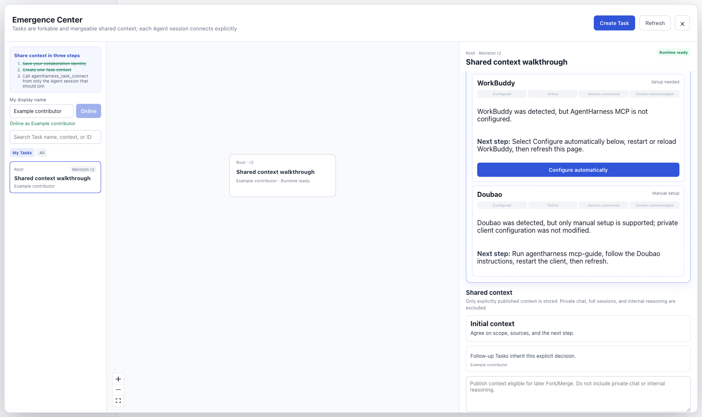

# AgentHarness

English | [中文](README.zh.md)

**One shared goal. Each person keeps their own agent.**

Frontend, backend, and ML engineers already have separate responsibilities, repositories, and permissions. AgentHarness connects their existing agent Sessions around a shared Task: authorized work updates become context for the other agents, without teammates copying each update or asking an agent to recall it. The [product principles](docs/whitepaper.md#human-responsibility) start from these human responsibilities; they do not assume that multiple agents outperform one agent with all the same access.

[Try it](#run) · [User guide](docs/user/guide/index.md) · [Design white paper](docs/whitepaper.md) · [Contribute](CONTRIBUTING.md)



The shared Task defines which context participants can receive. Agents exchange that context in the background; people can inspect its sources and permissions without maintaining a room conversation.

## Collaborate from existing native Sessions

This workflow describes the **current source preview**, using AgentHarness's built-in native Sessions. Published installers run their released version; check its [release notes](https://github.com/Oklahomawhore/AgentHarness/releases) for available controls. To try this checkout, follow the [source development guide](docs/development.md).

1. **Keep each person's workspace and Session.** Create a shared Task with the goal. Each participant keeps their running native Session and its existing local Task, history, and tools.
2. **Join the same shared scope.** The Task owner creates a collaboration entry. Participants review it, separately permit reading and collection, select directories, file operations or exact commands, and set limits. The owner reviews each application and assigns its responsibility. The [join guide](docs/user/guide/collaboration-network.md) covers both remote participants and the owner's local Agent.
3. **Continue ordinary work.** After approval, permitted Write/Edit operations and selected foreground command outcomes are collected automatically. Current shared context enters the receiving native Session's next model request; the Agent does not need a recall tool or a new conversation.
4. **Choose whether an idle Agent may respond.** Receiving alone stays passive. Each participant can separately authorize finite automatic responses to changes, with their own local goal and execution allowance. Joining does not grant an unlimited worker to the owner.

For a recommendation feature, each person continues work in their own area:

| Responsibility | Authorized work that can be shared | What another Agent can receive |
| --- | --- | --- |
| Frontend | Write or edit the card component and its expected response fields. | The fields needed to connect the UI. |
| Backend | Update the API description and run a selected integration command. | The changed interface and the command's success or failure. |
| ML | Update the ranking interface and run a selected evaluation command. | Output requirements and the recorded evaluation outcome. |

Collection covers selected operations, not every fact in a workspace. A model request already in progress is not rewritten. The source log and the receiving request show what was delivered; delivery alone does not prove that an Agent understood it or completed the work correctly.

Each owner keeps a separate Host and identity. Independent devices connect directly over a reachable IP address and TCP port; they **do not need a shared trusted cluster**. Listener setup and invitations are described in [cross-device collaboration](docs/user/guide/collaboration-network.md). Automatic internet discovery, NAT traversal, and relays are not available.

## Choose how context reaches an Agent

The default backend delivers bounded work reports without summary-model calls. Owners can opt into [model summaries](docs/user/guide/collaboration-semantic.md) that select context for each recipient's responsibility. Backends are replaceable plugins; embedding or latent communication is not implemented. Summary calls use the configured model account and can incur charges separately from the agents' ordinary requests.

Explicit publications remain useful for requirements, decisions, and inherited Task context. **Codex, Cursor, and other MCP clients** can connect a particular Session with `agentharness_task_connect` and receive updates on subsequent MCP calls. MCP configuration alone does not join a Session or provide native automatic collection and idle responses. **Claude Code hooks** support a separate opt-in file-sharing and receiving flow; they do not wake an idle Claude Session. See the [client guide](docs/user/guide/index.md) and [Claude collaboration controls](packages/collaboration/claude-scope/README.md).

<a id="run"></a>
## Try it

Use Node.js **22.19.x or a later 22.x release, or 24+**. On macOS/Linux, also install curl, tar, and sha256sum or shasum; Windows x64 needs PowerShell and tar. To install the published release, run:

```sh
npx --yes @sandboxbreak/agentharness
```

The installer downloads AgentHarness with its bundled DeepSeek Harness and portable Node runtime, starts the service, and opens the local app at `http://127.0.0.1:3080`. [GitHub Releases](https://github.com/Oklahomawhore/AgentHarness/releases) provides versioned installers and archives. Release contents can differ from this checkout.

**Creating a Task needs no model API key.** In the collaboration center, save a display name, choose **New task → New independent task**, and enter a name and initial context. You can publish a finding or decision under **Shared context**. Follow the [user guide](docs/user/guide/index.md) for service controls and client setup.

To use the built-in model conversation, close the center, choose a local project folder as your Workspace, and activate the conversation input. If no model is usable, the API-key dialog asks for your own DeepSeek key. The key is stored in your local Harness home and is not bundled in the release. Model-driven work requires a usable account and can incur charges.

Startup failures report the process exit code or readiness timeout and output from that launch.

## What to expect

AgentHarness is a **developer preview**; compatibility-breaking changes are expected. Reading, collection, and automatic work have separate permissions and limits. Responsibility guides context selection; it is not a privacy filter within the shared Task. Use a separate unshared Task for private work. Private chats, full Session histories, and internal reasoning are not published automatically.

Use the collaboration controls to stop sharing, withdraw contributed material, or leave receiving. Stopping collection can preserve reading and its separately authorized automatic responses; follow the [permission guide](docs/user/guide/collaboration-network.md) for the intended action. Model summaries and automatic execution have separate cumulative allowances.

A Task records shared context rather than approval or completion stages. Fork creates a new Task from a fixed parent revision; Merge combines selected publications from two or more fixed parent revisions. People remain responsible for conflicting conclusions and code changes. The [white paper](docs/whitepaper.md) describes the product direction; the [collaboration reference](packages/collaboration/README.md) covers its implementation.

## Project and upstream

AgentHarness is an independent project maintained by **Wangshu Zhu**, an algorithm engineer at a startup. **Neither the project nor its author is affiliated with or endorsed by DeepSeek.**

The project is built on [DeepSeek Harness](https://github.com/deepseek-ai/deepseek-harness) and [Cordis](https://github.com/cordiverse/cordis). It retains upstream package names and plugin architecture; [upstream provenance](UPSTREAM.md) records the pinned release and attribution. Model access uses your own credentials.

<a id="run-from-source"></a>
## Contribute and develop

Use the [development guide](docs/development.md) to run from source. Short-lived topic branches merge into the single development line, `main`, through PRs; releases use verified commits with version tags. The [contribution guide](CONTRIBUTING.md) explains the workflow. Reproducible examples of context handoffs, installation reports, and documentation improvements are useful contributions. Remove keys and private data from [issues](https://github.com/Oklahomawhore/AgentHarness/issues) and [pull requests](https://github.com/Oklahomawhore/AgentHarness/pulls). Agents should follow [AGENTS.md](AGENTS.md).

## License

[MIT](LICENSE) · AgentHarness copyright © 2026 **Wangshu Zhu**. Upstream and third-party notices are retained in [Third-Party Notices](THIRD_PARTY_NOTICES.md).
