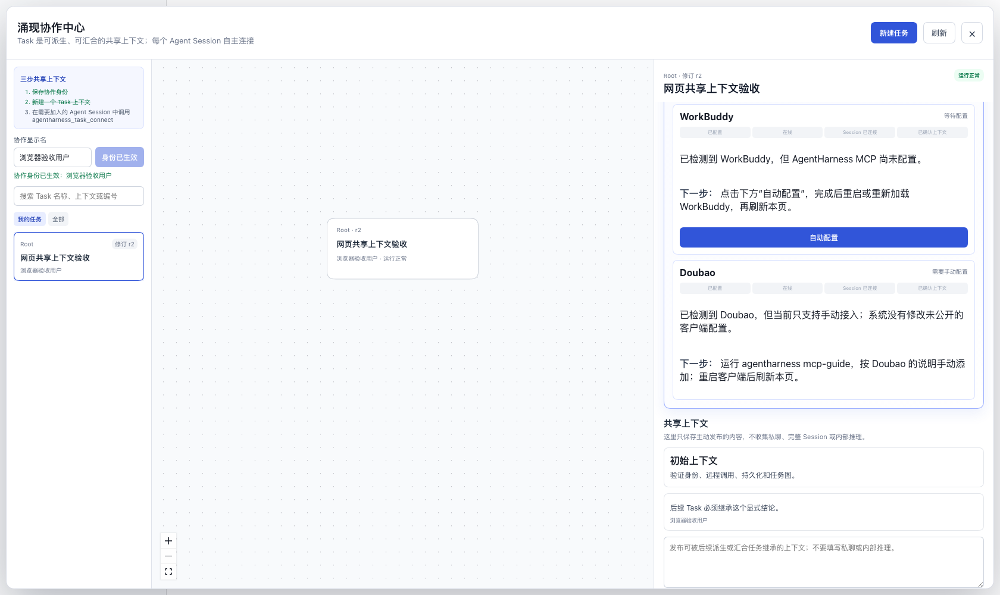

# AgentHarness

[English](README.md) | 中文

**同一个目标，每个人保留自己的 Agent。**

前端、后端和算法已经拥有各自的职责、代码库和权限。AgentHarness 围绕共享 Task 连接他们已有的 Agent Session：获授权的工作更新成为其他 Agent 的上下文，队友无需逐条复制更新，也无需让 Agent 手动 recall（检索记忆）。[产品原则](docs/whitepaper.zh.md#human-responsibility)从这些人的职责出发，不预设多个 Agent 优于拥有同等全部权限的单个 Agent。

[立即体验](#run) · [用户指南](docs/user/guide/index.zh.md) · [设计白皮书](docs/whitepaper.zh.md) · [参与贡献](CONTRIBUTING.zh.md)



共享 Task 划定参与者可以接收的上下文范围。Agent 在后台交换这些上下文，人可以检查来源和权限，无需维护一段房间对话。

## 从已有原生 Session 开始协作

以下流程描述**当前源码预览版**，使用 AgentHarness 内置的原生 Session。安装器运行已发布的版本；可用控件以对应的[发布说明](https://github.com/Oklahomawhore/AgentHarness/releases)为准。体验当前检出源码请遵循[源码开发指南](docs/development.zh.md)。

1. **保留每个人的工作区和 Session。** 创建共享 Task，写下目标。每位参与者保留正在运行的原生 Session，以及已有的本地 Task、历史和工具。
2. **加入同一个共享范围。** Task 所有者生成协作入口。参与者检查入口，分别同意接收和采集，选择目录、文件操作或精确命令，并设置额度。所有者审核各项申请并指定职责。[加入指南](docs/user/guide/collaboration-network.zh.md)涵盖远端参与者和所有者自己的本地 Agent。
3. **继续日常工作。** 批准后，允许的 Write/Edit 操作和选定的前台命令结果会自动采集。当前共享上下文进入接收方原生 Session 的下一次模型请求；Agent 无需调用 recall 工具，也无需开启新会话。
4. **选择空闲 Agent 是否可以响应。** 仅接收上下文时保持被动。每位参与者可以另行授权有限的自动响应，指定自己的本地目标和执行额度。加入协作不会授予所有者一个无限执行的工作者。

以推荐功能为例，每个人继续负责自己的部分：

| 职责 | 可以共享的授权工作 | 其他 Agent 可以接收什么 |
| --- | --- | --- |
| 前端 | 编写或修改卡片组件及其预期的响应字段。 | 页面接入所需的字段。 |
| 后端 | 更新接口说明，执行选定的联调命令。 | 变化后的接口，以及命令成功或失败的结果。 |
| 算法 | 更新排序接口，执行选定的评估命令。 | 输出要求和记录下来的评估结果。 |

采集只覆盖选定操作，不涵盖工作区中的所有事实。已经进行中的模型请求不会被改写。来源日志和接收方请求说明实际投递了什么；投递本身不证明 Agent 理解了信息或正确完成了工作。

每个所有者保留独立的 Host 和身份。独立设备通过可达的 IP 地址和 TCP 端口直连，**无需加入同一个受信任集群**。监听设置和邀请流程见[跨设备协作](docs/user/guide/collaboration-network.zh.md)。目前没有自动互联网发现、NAT 穿透和中继。

## 选择上下文如何到达 Agent

默认后端投递有大小限制的工作报告，不调用摘要模型。所有者可以选择[模型摘要](docs/user/guide/collaboration-semantic.zh.md)，按接收方职责选择上下文。后端可通过插件替换；尚未实现 embedding 或潜在表示通信。摘要调用使用所配置的模型账户，可能产生独立于 Agent 普通请求的费用。

主动发布仍适用于需求、决策，以及供其他 Task 继承的上下文。**Codex、Cursor 和其他 MCP 客户端**可以通过 `agentharness_task_connect` 连接一个具体 Session，并在后续 MCP 调用时接收更新。仅配置 MCP 不会加入 Session，也不提供原生的自动采集和空闲响应能力。**Claude Code hooks**支持另行选择的文件共享和接收流程，不会唤醒空闲 Claude Session。详见[客户端指南](docs/user/guide/index.zh.md)和 [Claude 协作控件](packages/collaboration/claude-scope/README.zh.md)。

<a id="run"></a>
## 立即体验

使用 Node.js **22.19.x 或更新的 22.x 版本，或 24+**。macOS/Linux 还需要 curl、tar 和 sha256sum 或 shasum；Windows x64 需要 PowerShell 和 tar。安装已发布版本请运行：

```sh
npx --yes @sandboxbreak/agentharness
```

安装器下载 AgentHarness 及其内含的 DeepSeek Harness 和便携 Node 运行时，启动服务，并在 `http://127.0.0.1:3080` 打开本地应用。[GitHub Releases](https://github.com/Oklahomawhore/AgentHarness/releases)提供带版本的安装脚本与归档文件。发布内容可能与当前检出源码不同。

**创建 Task 无需模型 API key。** 在协作中心保存显示名，选择**新建任务 → 新建独立任务**，填写名称和初始上下文。你可以在**共享上下文**中发布发现或决策。服务管理和客户端设置见[用户指南](docs/user/guide/index.zh.md)。

使用内置模型对话时，先关闭协作中心，选择本机项目目录作为工作区，再点击对话输入区。如果尚无可用模型，API key 对话框会要求填写你自己的 DeepSeek key。密钥保存在本机 Harness home 中，不包含在发行包里。模型驱动的工作需要可用账户，并可能产生费用。

启动失败会报告进程退出码或就绪超时，并展示本次启动的输出。

## 使用范围

AgentHarness 处于**开发者预览阶段**，未来可能有破坏兼容性的变更。接收、采集和自动工作分别有自己的权限与额度。职责用于选择上下文，不是共享 Task 内的隐私过滤器。私密工作应使用独立且未共享的 Task。私聊、完整 Session 历史和内部推理不会自动公开。

使用协作控件停止共享、撤回贡献材料或离开接收。停止采集可以保留接收，以及另行授权的自动响应；请按[权限指南](docs/user/guide/collaboration-network.zh.md)执行相应操作。模型摘要和自动执行各自累计额度。

Task 记录共享上下文，不提供审批或完成阶段。派生（Fork）从固定父版本创建新 Task；汇合（Merge）组合两个或更多固定父版本中选定的发布内容。相互矛盾的结论和代码变更仍由人负责。[白皮书](docs/whitepaper.zh.md)描述产品方向，[协作参考文档](packages/collaboration/README.zh.md)说明具体实现。

## 项目与上游

AgentHarness 是由初创公司算法工程师 **Wangshu Zhu** 独立维护的项目。**本项目及作者均不隶属于 DeepSeek，也未获得 DeepSeek 的官方背书。**

项目基于 [DeepSeek Harness](https://github.com/deepseek-ai/deepseek-harness) 和 [Cordis](https://github.com/cordiverse/cordis) 构建，保留上游包名与插件架构；[上游来源说明](UPSTREAM.zh.md)记录固定的版本和归属信息。模型访问使用你自己的凭据。

<a id="run-from-source"></a>
## 参与和开发

从源码运行见[开发指南](docs/development.zh.md)。短期主题分支通过 PR（Pull Request）合入唯一开发主线 `main`；发布时为经过验证的提交打版本 tag。[贡献指南](CONTRIBUTING.zh.md)说明具体流程。欢迎提供可复现的上下文交接示例、安装问题报告，以及文档改进。在 [Issue](https://github.com/Oklahomawhore/AgentHarness/issues) 和 [PR](https://github.com/Oklahomawhore/AgentHarness/pulls) 中请移除密钥及私人数据。Agent 应遵守 [AGENTS.md](AGENTS.md)。

## 许可证

[MIT](LICENSE) · AgentHarness 版权所有 © 2026 **Wangshu Zhu**。上游及第三方版权声明见 [Third-Party Notices](THIRD_PARTY_NOTICES.md)。
